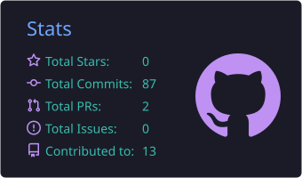
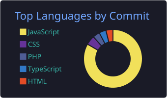

  <i>I take an idea from an empty folder to a live link — 
  the screen you see, the API behind it, and the database under that.</i>

  
  &nbsp;&nbsp;&nbsp;
  
  &nbsp;&nbsp;&nbsp;
  

 

|  |  |
| :-- | :-- |
| 📚 **Learning** | Full Stack Python, Next.js + TypeScript, AI & ML |
| 🛠️ **Building** | Projects that solve real problems |
| 🧩 **Solving** | LeetCode, a little every week |

 

## Tech Stack

### Frontend

### Backend

### Database

### DevOps & Tools

### AI / ML &nbsp;(learning)

 

## Projects

| Project | Type |
| :-- | :-- |
| **SSSI Website** | Website |
| **Allora** | Desktop application |
| **NGA School ERP** | School management system |
| [**My Spotify**](https://github.com/Dattadhongade/Myspotify.com) | Music web app |
| **Forever Buy** | E-commerce |

More on my [portfolio](https://dattas-code-lab.vercel.app/) and in my [repositories](https://github.com/Dattadhongade?tab=repositories).

 

## GitHub Stats

  
  

 

## LeetCode

 

Open to opportunities and collaboration. The best way to reach me is LinkedIn.
